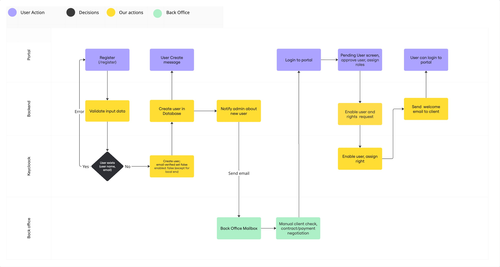

# User onboarding Overview

This document explains how new users are reigster in platform.

## Overview

## New User registration

-  Users starts  by filling up register form in Portal.
-  Backend created new user in database and Keycloack as disabled.
-  Notification email is send to platform owner.
-  Platform owner check user, negotiated contract etc. This happens outiside platform.
-  Once owner is fine with new user, owner logins to platform on enables user. By enabling user, he can set also permission, that user will have.
-  User enablling triggers welcome email notification to user.
-  Now new user can login to portal.

NOTE: option if user is created as disabled, will be controlled by enviroment variable. In automated tests this will be altered and user will be created as enabled.
